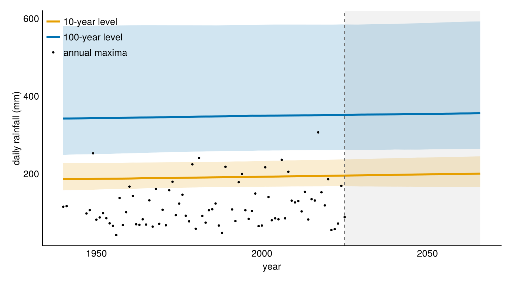

## 2026 Levels

- 10 year rainfall 195 mm
- 10 year 95% interval 168 to 237 mm
- 100 year rainfall 352 mm
- 100 year 95% interval 261 to 584 mm

## Change

| Period | Median | 95% interval |
|---|---:|---:|
| 1986 to 2026 | 4 mm increase | 7 mm decrease to 16 mm increase |
| 2026 to 2066 | 4 mm increase | 7 mm decrease to 16 mm increase |

\vspace{0.6cm}

\begin{center}
\Large
\textbf{0.11 mm per year}

\normalsize
95\% interval 0.17 mm decrease to 0.39 mm increase

\vspace{0.4cm}

Published estimate 1.93 mm per year
\end{center}

## Model

$$
Y_t \sim \operatorname{GEV}(\mu_t,\sigma,\xi)
$$

$$
\mu_t=\alpha_0+\alpha_1(t-2006)
$$

$$
P(Y_t>z_T)=\frac{1}{T}
$$

$$
z_T(t)=\mu_t+\frac{\sigma}{\xi}
\left[
\left\{-\log\left(1-\frac{1}{T}\right)\right\}^{-\xi}-1
\right]
$$

## Return Levels

{width=96%}

## Conclusion

- No clear trend
- The trend interval includes zero
- 80 annual maxima from 1940 to 2025
- Bayesian GEV with a linear location trend
- The 2066 projection continues the historical linear trend
